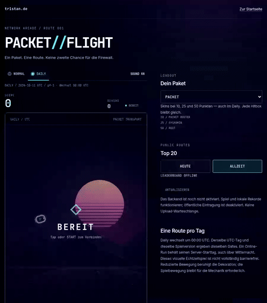

# PACKET//FLIGHT — visueller Entwurf

Ausgangsstand: `main`, `99e1597bf4b33f6f6f43cd88aa4c43b9ed2839fd`
(gemergter PR #2). Neuer Branch: `codex/packet-flight-visuals`.
Umsetzung und Prüfung ausschließlich in der entfernten Codex-Cloud.

## Umsetzung

- Eigene Canvas-Netzwerklandschaft mit gestreiftem Kern, zwei Wireframe-Ebenen,
  Server-Silhouetten, perspektivischem Grid und vereinzelten Datenimpulsen.
  Die Ebenen bewegen sich unterschiedlich schnell und halten bei Pause an.
- Firewall-Gates mit abgeschrägtem Gehäuse, Leiterbahnen, Ports und eindeutig
  markierten Passagen; kurze Bestätigung beim vollständigen Passieren.
- Skinfarbene Sprungimpulse, kantige Partikel, kurze Ringe, verblassende
  Konturen, Neigung und Stauchung. `+1` beim Punktgewinn, einmaliger Zerfall
  bei Kollision, anschließend ein ruhiger Game-Over-Dialog.
- Kompakte Modus-/Sound-Leiste und priorisierter Score. Start, Neustart,
  Pause, Skins, Rekorde, Fokusmanagement und vorbereitete Rangliste erhalten.
  Container Queries verhindern die bei 200 % Zoom gefundene HUD-Überlappung.
- Homepage: beide Hero-Links und Spiel-/Ranglisten-Chips entfernt; `play`,
  `play --daily`, `leaderboard`, Hilfe und Tab-Vervollständigung erhalten.
  Schmalerer transparenter Header, auslaufender Hero-Scrim ohne abgeschnittene
  Rechteckkante; bestehende Szene, Texte und Terminal erhalten.
- Neuer Offline-Shell-Cache, Versions-URLs für geänderte CSS-/JS-Dateien,
  Neuinstallation ohne veraltete HTTP-Cache-Antworten.

`game/physics.mjs`, `game/rules.mjs`, Regelversion und Daily-Generator sind
unverändert. Effekte haben einen eigenen RNG und begrenzte Speicher:
64 Partikel, 9 Konturen, 4 Ringe, 3 Punktlabels, 3 Gate-Bestätigungen.
Neustart setzt alles zurück. Es bleibt eine einzige RAF-Schleife; keine
Listener oder Timer pro Run. Reduced Motion stoppt Hintergrundbewegung,
entfernt Ringe/Schweif/Stauchung und reduziert Partikel auf höchstens zwei.

## Tatsächlich ausgeführte Prüfungen

| Prüfung | Ergebnis |
| --- | --- |
| `node --test tests/game.test.mjs` | 13 bestanden |
| `python3 tests/site_test.py` | 2 bestanden |
| `python3 tests/browser_test.py` | 12 bestanden |
| `python3 tests/visual_browser_test.py` | 7 bestanden |
| Worker `npm test`: Dry Run + isoliertes workerd/Miniflare/D1 | 10 bestanden |
| HTML-Validate 10.5.0: Homepage, Spiel, Datenschutz, Impressum, 404 | keine Fehler |

44 unterschiedliche Testfälle. Die zusätzliche Zoom-Prüfung wurde nach der
HUD-Korrektur erneut ausgeführt. Die Worker-Prüfung führt **keinen Deployment**
aus und schreibt ausschließlich isolierte Testdaten.

Abgedeckt sind Daily-/Physikvergleich mit/ohne Effekte und allen Skins,
60/120/144/240 Hz, Hitboxen/Punktzählung, 100 Effektspeicher-Resets,
zwölf Browser-Neustarts ohne zusätzliche RAF-Schleifen, Pause/Countdown/
Game Over ohne Sprungeffekte, Reduced Motion einschließlich Live-Wechsel,
Normal-/Daily-Runs mit Tastatureingaben und Rekorden nach Reload, Terminal/
Tab/Shift+Tab, freiwillige Eintragung, verlorene Antworten, Storage/Audiofehler,
Ranglistendarstellung und echtes Offline-Neuladen mit neuen Assets und
Löschung des alten Shell-Caches.

Visuell in Cloud-Chromium geprüft: 320×568, 390×844, 430×932, 768×1024,
1440×900, Querformat 844×390; 200 % Reflow und Chromium-Pinch-Zoom,
Reduced Motion, Start-, Pause-, Lauf- und Game-Over-Zustände.
Homepage und Spiel auf horizontalen Überlauf geprüft, HUD/Bedienelemente
auf Überlappung. Die Homepage-Aufnahmen während des Scrollens warten auf
die bestehende Einblendung des Terminals.

## Vorher / Nachher

Die Vorher-Bilder stammen aus der unveränderten Arbeitskopie des oben genannten
`main`-Commits, vor den Quelltextänderungen. Vergleichsbilder verwenden gleiche
Viewports und Reduced Motion. Es sind vollständige Seitenaufnahmen; feststehende
Dekoration wird dabei nur im ersten Viewport abgebildet. Die zusätzliche
Scroll-Aufnahme zeigt den tatsächlichen bewegten Übergang zum Terminal.

| Ansicht | Vorher | Nachher |
| --- | --- | --- |
| Homepage · 1440×900 | [PNG](packet-flight-visuals/before-home-desktop.png) | [PNG](packet-flight-visuals/after-home-desktop.png) |
| Spiel · 1440×900 | [PNG](packet-flight-visuals/before-game-desktop.png) | [PNG](packet-flight-visuals/after-game-desktop.png) |
| Homepage · 390×844 | [PNG](packet-flight-visuals/before-home-mobile.png) | [PNG](packet-flight-visuals/after-home-mobile.png) |
| Spiel · 390×844 | [PNG](packet-flight-visuals/before-game-mobile.png) | [PNG](packet-flight-visuals/after-game-mobile.png) |

[Homepage beim Scrollen](packet-flight-visuals/after-home-transition.png) ·
[Sprung](packet-flight-visuals/after-game-jump.png) ·
[Punktgewinn](packet-flight-visuals/after-game-point.png) ·
[Game Over](packet-flight-visuals/after-game-over.png)

### Aufnahme in Echtzeit

[MP4, ca. 13 Sekunden](packet-flight-visuals/packet-flight-motion.mp4).
Daily-Run mit echten Space-Eingaben: elf Sprünge, drei Punkte, eine Kollision.
Testbeobachter zählen Ereignisse und lesen Positionen; sie verändern keine
Physik, Seeds oder Scores. Die Standbilder der Effekte verwenden kontrollierte
Browserzeit; das Video verwendet die echte Uhr.

Aufnahmen reproduzieren: [Cloud-Testanleitung](../tests/README.md).

## Stand und Grenzen

- Implementiert und in der Cloud getestet; zur Review auf einem neuen Branch.
- Kein Merge und keine GitHub-Pages-Veröffentlichung dieses Entwurfs.
- `API_URL = ''`; Worker `ENABLED = "false"`. Keine Cloudflare-Aktivierung,
  keine öffentliche Rangliste und keine Upload-Warteschlange.
- Keine neuen Laufzeit-Abhängigkeiten, kein Build für Besucher.
- Impressum, Datenschutz, Hosting, Domain, DNS und Mail unverändert.
- Headless Chromium und Viewport-/Zoom-Emulation ersetzen keine Prüfung auf
  physischen iOS-/Android-Geräten oder in Safari/Firefox. Das visuelle
  Echtzeitspiel wird nicht als vollständig barrierefrei bezeichnet.
